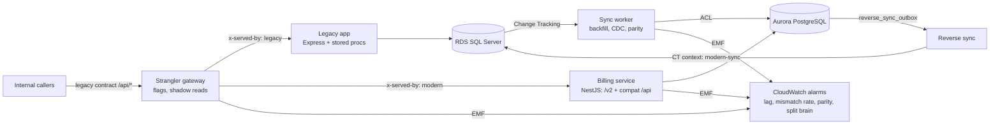

# legacy-strangler-migration

Moving a 15-year-old customer/billing system off SQL Server **without a big-bang cutover**: a NestJS service on PostgreSQL grows route by route and tenant by tenant behind a routing facade, fed by change data capture, verified by shadow reads and a parity checker, with a rollback that is one API call.

The legacy side is real enough to hurt: a denormalized SQL Server schema with `nvarchar` dates in two formats, magic status codes, triggers that write to other tables, no foreign keys, stored procedures behind a thin Express API, and seeded data with the usual garbage.

## What it handles

| Problem | How it is handled | Where |
|---|---|---|
| Big-bang rewrite risk | Strangler Fig: facade owns the contract, traffic moves per route/tenant/customer | [ADR 0001](docs/adr/0001-strangler-fig-over-big-bang-rewrite.md), [cutover plan](docs/cutover-plan.md) |
| Getting legacy data out continuously | SQL Server Change Tracking polled in snapshot transactions; checkpoint advanced in the same PostgreSQL transaction as the data; batches never split a legacy transaction; AWS DMS as the production alternative | [ADR 0002](docs/adr/0002-cdc-with-sql-server-change-tracking.md), [cdc-worker.ts](src/sync/cdc-worker.ts), [change-tracking.ts](src/sync/change-tracking.ts) |
| Initial load without hurting the legacy primary | Keyset backfill, token-bucket throttle, resumable per table, seamless hand-over to CDC at the snapshot version | [backfill.ts](src/sync/backfill.ts) |
| Replays, crashes, out-of-order applies | `source_version` guard on every upsert → idempotent; crash before commit = batch replayed | [projector.ts](src/sync/projector.ts), [sync tests](test/sync.int-spec.ts) |
| Dual writes / split brain | Single writer per entity and tenant; CDC refuses legacy writes to modern-owned data; reverse sync with Change Tracking context to suppress echoes | [ADR 0003](docs/adr/0003-single-writer-per-entity.md), [reverse-sync.ts](src/sync/reverse-sync.ts), [006_reverse_sync.sql](legacy/sql/006_reverse_sync.sql) |
| Legacy concepts leaking into the new model | Anti-corruption layer: codes, dates, documents, money, ids; repairs recorded as `data_issues`, unknowable values dead-lettered | [ADR 0004](docs/adr/0004-anti-corruption-layer.md), [src/acl](src/acl) |
| Gradual, reversible traffic shift | Pure `decide()`: kill switch → write owner → sticky `sha256(tenant:customer)` bucket vs per-route/tenant percentage; audited admin API | [ADR 0005](docs/adr/0005-feature-flag-routing.md), [flags.ts](src/gateway/flags.ts) |
| "Is the new system answering the same thing?" | Sampled shadow reads compared in canonical form (accepted differences are explicit rules); mismatch rate metric + alarm | [ADR 0006](docs/adr/0006-verification-shadow-reads-and-parity.md), [canonical.ts](src/gateway/shadow/canonical.ts) |
| "Is the data the same?" | Parity checker: counts + SHA-256 per tenant × id-bucket over the translated form, drill-down to row ids, recheck to filter lag | [parity.ts](src/sync/parity.ts) |

## Architecture



More in [docs/architecture.md](docs/architecture.md) (containers, sequence diagrams, migration phases).

## Run locally

Requirements: Node 22, Docker (SQL Server needs ~2 GB RAM). Host ports: 1434 (SQL Server), 5434 (PostgreSQL), 3400–3402 (apps). The compose file also has LocalStack on 4570 (Secrets Manager, CloudWatch Logs) for experimenting with the AWS side; the apps themselves read plain env vars locally.

```bash
cp .env.example .env
docker compose up -d --wait mssql postgres
npm ci && npm run build
npm run legacy:init        # schema, triggers, procedures, 3,000 seeded customers
npm run migrate            # PostgreSQL schema
npm run sync:backfill      # initial load (throttled), then:
npm run sync:cdc &         # Change Tracking -> PostgreSQL
npm run start:legacy &     # :3401
npm run start:billing &    # :3402
npm run start:gateway &    # :3400 (callers use this)
```

Shift traffic:

```bash
A=(-H 'x-admin-token: local-admin-token-change-me' -H 'x-admin-actor: me' -H 'content-type: application/json')

# shadow-compare every customer read, still served by legacy
curl -X PUT "${A[@]}" localhost:3400/admin/rules -d '{"routeId":"customers.get","tenantId":"*","modernPercent":0,"shadowPercent":100}'
curl -H 'x-tenant-id: GLOBEX' localhost:3400/api/customers/10 -i | grep x-served-by
curl "${A[@]}" localhost:3400/admin/shadow/stats

# canary 30 % of customers (sticky), then roll everything back
curl -X PUT "${A[@]}" localhost:3400/admin/rules -d '{"routeId":"customers.get","tenantId":"*","modernPercent":30,"shadowPercent":10}'
curl -X POST "${A[@]}" localhost:3400/admin/kill-switch -d '{"on":true}'
```

`docker compose down` when done.

## API

Public contract (preserved by the gateway, served by either side):

| Method | Path | Kind | Notes |
|---|---|---|---|
| `GET` | `/api/customers?after=&top=` | read | keyset by legacy id |
| `GET` | `/api/customers/:id` | read | sticky key = customer id |
| `POST` | `/api/customers` | write | routed to the owner of `customers` for the tenant |
| `PUT` | `/api/customers/:id` | write | idem |
| `GET` | `/api/customers/:id/invoices` | read | |
| `POST` | `/api/invoices/:id/pay` | write | legacy-owned in this phase (R-03) |

All require `X-Tenant-Id`. Responses carry `x-served-by` and `x-route-reason`; reads that fell back carry `x-fallback: true`. Unknown `/api/*` routes are forwarded to legacy untouched.

Modern API: `GET /v2/customers`, `/v2/customers/:uuid`, `/v2/customers/:uuid/invoices` (ISO dates, explicit statuses, decimal-string money, RFC 9457 errors).

Admin (ops VPN + token + actor): `GET /admin/flags`, `PUT /admin/rules`, `POST /admin/kill-switch`, `PUT /admin/ownership`, `GET /admin/shadow/stats`.

Sync worker: `node dist/sync/main.js backfill | cdc | reverse | parity`.

## Tests

```bash
npm test          # unit: 51 tests (ACL, decide(), canonical diff, batching, throttle, checksums, ...)
npm run test:int  # integration: 18 tests, Testcontainers SQL Server 2022 CU14 + PostgreSQL 16
```

Integration suites ([test/](test)) cover: backfill with tombstones and orphan dead letters; CDC inserts/updates/soft+hard deletes and trigger side effects; one 200-row transaction read with batch size 7 (no split); idempotent replay from the snapshot; backfill crash + resume with changes made meanwhile; crash before commit and convergence; modern writes rejected for non-owners; reverse sync with echo suppression and IDENTITY range preserved; split-brain detection; sticky percentage routing and tenant overrides through the real gateway; kill switch + audit; owner-routed writes; shadow reads with zero false positives on 60 customers and detection of a tampered row; parity drill-down to drifted/missing/extra rows; fallback when modern is down.

## Measured locally

Laptop, Docker Desktop, shared with other builds; 3,000 customers / 12,005 invoices. Backfill 5.3 s unthrottled (9.4 s at 2,000 rows/s); single-row replication lag p50 0.94 s (poll interval 1 s); 6,000 shadow comparisons with 0 mismatches; parity on all 15,000 rows in 2.3 s. The run also found a real defect (PostgreSQL bind-parameter limit on a 12,000-row legacy transaction), fixed since. Details and caveats: [docs/local-run.md](docs/local-run.md).

## Deploy

- [`infra/strangler-migration.yaml`](infra/strangler-migration.yaml) (cfn-lint clean): RDS SQL Server (or an existing endpoint), Aurora PostgreSQL Serverless v2, Secrets Manager (managed DB secrets, sync login, admin token), ECS Fargate services for gateway, billing (Service Connect), CDC (1 task) and reverse sync (0/1), hourly parity via EventBridge Scheduler, internal ALB with `/admin/*` restricted to the ops VPN, alarms on replication lag, shadow mismatch rate (metric math), parity, dead letters, reverse-sync backlog and fallbacks.
- [`Dockerfile`](Dockerfile): one image, the task definition picks the entrypoint.
- [`.github/workflows/ci.yml`](.github/workflows/ci.yml): typecheck, lint, prettier, unit + coverage, Testcontainers integration, cfn-lint, image build.

## Docs

[Architecture](docs/architecture.md) · [ADRs](docs/adr) · [Cutover & rollback plan](docs/cutover-plan.md) · [Runbook](docs/runbook.md) · [Risk register](docs/risk-register.md) · [Threat model](docs/threat-model.md) · [Local run](docs/local-run.md)

## Not done (yet)

- Write freeze per tenant is procedural (pause callers); a gateway freeze flag is on the backlog.
- Invoice write ownership cannot flip until `TRG_INV_PAID`'s customer-unblock rule moves to the modern service (R-03).
- Admin API uses a shared token + actor header, not per-user IAM auth.
- No load test against AWS; the numbers above are from a laptop.
