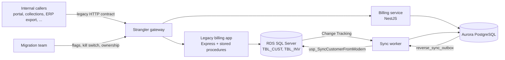
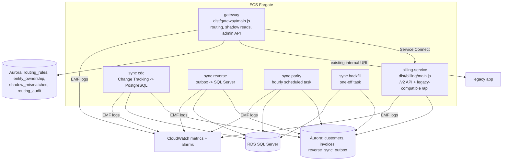
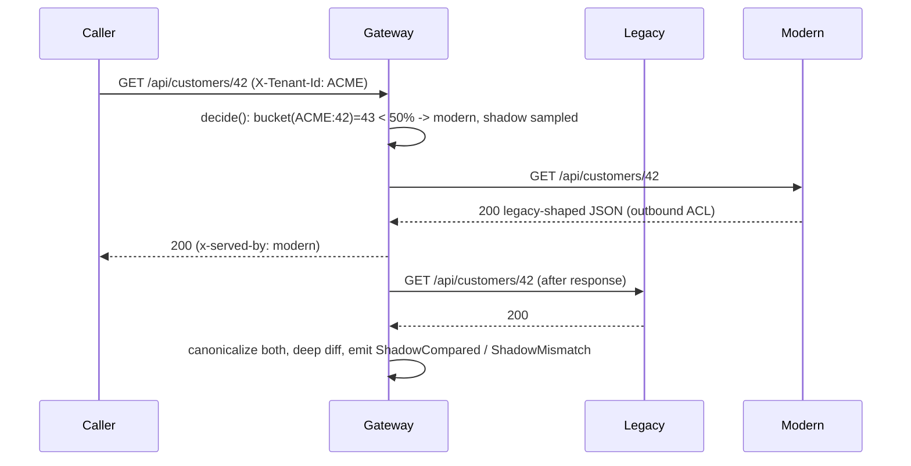
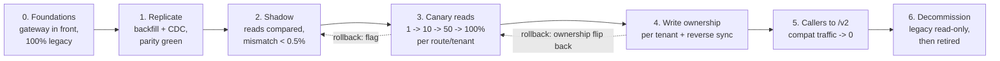

# Architecture

## System context (C4 level 1)



## Containers (C4 level 2)



One image, one codebase; the ECS task definition selects the entrypoint. The gateway and the billing service share the Aurora cluster (separate tables); in a larger organisation the gateway's flag tables would move to AppConfig ([ADR 0005](adr/0005-feature-flag-routing.md)).

## Code map

| Path | Role | Deleted at decommission? |
|---|---|---|
| `legacy/sql/` | Legacy schema, triggers, procedures, seed (the system being replaced) | yes |
| `src/legacy/` | Legacy Express app + its HTTP contract types | yes |
| `src/billing/domain/` | Clean domain: `Customer`, `Invoice`, value objects | no |
| `src/billing/api/` | `/v2` API | no |
| `src/billing/compat/` | Legacy-compatible endpoints, modern-side writes with ownership check | yes |
| `src/acl/` | Anti-corruption layer (codes, dates, documents, money, ids) | yes |
| `src/gateway/` | Facade: route table, `decide()`, flag store, shadow reads, admin API | yes |
| `src/sync/` | Backfill, CDC worker, projector, reverse sync, parity checker | yes |
| `src/shared/` | Config, database, Nest core module, logging, tracing, EMF metrics | no |

## Data flow of a read during a canary phase



## Data flow of a legacy write

```mermaid
sequenceDiagram
  participant L as Legacy app
  participant S as SQL Server
  participant W as CDC worker
  participant P as PostgreSQL
  L->>S: EXEC usp_PayInvoice (trigger unblocks customer)
  S->>S: Change Tracking records TBL_INV + TBL_CUST (same version)
  W->>P: BEGIN; SELECT checkpoint FOR UPDATE
  W->>S: SNAPSHOT: CHANGETABLE(CHANGES ..., checkpoint) JOIN base rows
  W->>W: ACL translate, dead-letter rejects / orphans / non-owner writes
  W->>P: upsert ... WHERE source_version < excluded.source_version
  W->>P: UPDATE checkpoint; COMMIT
```

## Migration phases



Entry/exit criteria and rollback per phase: [cutover-plan.md](cutover-plan.md).

## Observability

- **Logs**: pino JSON, one line per request with `x-request-id` propagated by the gateway to both upstreams, so a shadow read's two calls share the id. Admin token and auth headers redacted.
- **Traces**: OpenTelemetry Node SDK (http, express, pg, tedious auto-instrumentation) exporting OTLP to the ADOT sidecar → X-Ray; `traceparent` forwarded through the facade.
- **Metrics** (CloudWatch EMF, namespace `StranglerMigration`): `GatewayRequests{Route,Target}`, `UpstreamLatency`, `GatewayFallback`, `ShadowCompared/ShadowMismatch/ShadowError/ShadowLatencyDelta{Route}`, `ReplicationLagSeconds/SyncChangesApplied/SyncDeadLettered/SyncEchoesSkipped{Stream}`, `BackfillRows/BackfillThrottled`, `ReverseSyncBacklog`, `ParityMismatchedPartitions`.
- **Health**: `/health/live` (process) and `/health/ready` (PostgreSQL / SQL Server reachable) on every HTTP process.
